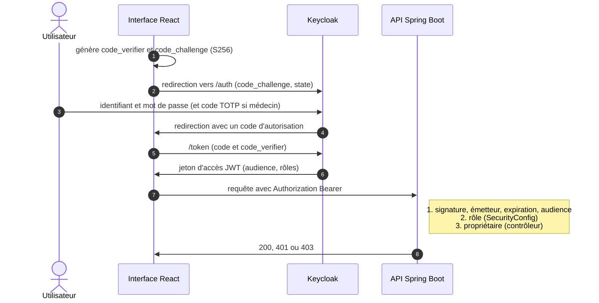
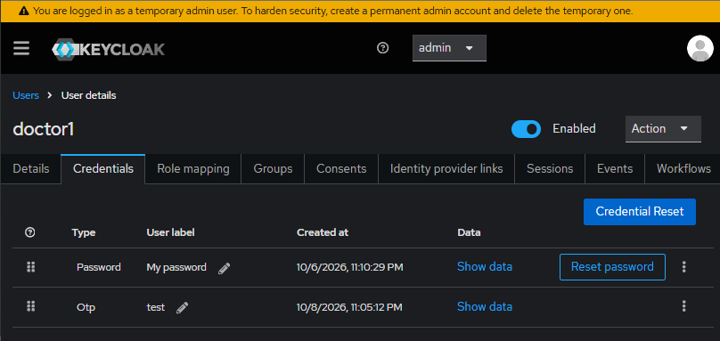

# MediCare : portail médical sécurisé par Keycloak

Le but de ce projet est de sécuriser **medicare-app**, un portail de rendez-vous médicaux **fictif**, avec
[Keycloak](https://www.keycloak.org/) (OAuth 2.0, OpenID Connect, Authorization Code + **PKCE**). `medicare-app`
se compose de deux applications : une API REST Spring Boot, **medicare-api**, et une application React,
**medicare-ui**. Projet pédagogique de cybersécurité (PFE).

> Toutes les données sont fictives. Les comptes de démonstration (mot de passe = nom d'utilisateur) et la
> configuration Keycloak en mode développement sont **réservés à l'usage local**.


## Schéma du projet


| Étape | Ce qui se passe |
|---|---|
| ① | L'utilisateur ouvre `medicare-ui` |
| ② | `medicare-ui` le redirige vers Keycloak (Authorization Code + PKCE `S256`) |
| ③ | Il saisit son identifiant et son mot de passe **chez Keycloak** (et un code TOTP s'il est médecin) |
| ④ | Keycloak renvoie à `medicare-ui` un **jeton d'accès JWT** signé (RS256) : rôles et audience `medicare-api` |
| ⑤ | `medicare-ui` appelle `medicare-api` avec `Authorization: Bearer <jeton>` |
| ⑥ | `medicare-api` valide le jeton avec les clés **publiques** de Keycloak (JWKS) : signature, émetteur, expiration, audience |
| ⑦ | `medicare-api` contrôle le **rôle** puis l'**objet** (le `sub` du jeton contre le propriétaire de la donnée) |
| ⑧ | `medicare-api` répond `200`, `401` ou `403` |

Déroulement détaillé d'une session :



## Ce que le projet démontre

| Protection | Comment | Preuve |
|---|---|---|
| Connexion sans mot de passe dans l'application | Authorization Code + PKCE `S256`, client public | Un `code_verifier` incorrect est refusé (`invalid_grant`) |
| Jeton infalsifiable | JWT signé RS256, vérifié avec les clés publiques (JWKS) de Keycloak | Un jeton modifié est rejeté : `Invalid signature` |
| Jeton destiné à cette API uniquement | Validation de l'audience `aud = medicare-api` | Un jeton émis pour une autre API est rejeté |
| Moindre privilège par rôle | 4 rôles, zones d'API distinctes (RBAC) | Matrice 4 rôles × 4 zones : 16 cas conformes |
| Contrôle d'accès par objet (anti-IDOR) | Le `sub` du jeton est comparé au propriétaire de la donnée | Un patient ne peut pas lire le dossier d'un autre patient (403) |
| Séparation des tâches | Secrétaire et administrateur sans accès au contenu médical | Dossier médical refusé aux deux (403) |
| Authentification forte des médecins | Flux Keycloak conditionnel : code TOTP exigé seulement pour `DOCTOR` | Un patient se connecte sans code, un médecin doit en saisir un |
| Traçabilité | Chaque décision au niveau de l'objet est journalisée (`ALLOWED` / `DENIED`) | Le journal est consultable par l'administrateur |

**27 scénarios automatiques** vérifient les accès par rôle et par objet ; les attaques sur le jeton et le
flux PKCE sont testées une à une (voir [Tests de sécurité](#tests-de-sécurité)).

## Applications

### medicare-api

Application web Java (Spring Boot, Java 21) qui expose une API REST de gestion de rendez-vous et de dossiers
médicaux. Ses endpoints ne sont accessibles qu'avec un **jeton d'accès (JWT) émis par Keycloak**. Les données
sont fictives et gardées **en mémoire** (voir [Limites connues](#limites-connues)).

| Endpoint | Sécurisé | Rôles | Règle supplémentaire |
|---|---|---|---|
| `GET /api/health` | Non | | |
| `GET /api/me` | Oui | tout utilisateur authentifié | identité et autorités lues dans le jeton |
| `GET /api/appointments` | Oui | `PATIENT`, `DOCTOR`, `SECRETARY` | résultat filtré selon le rôle |
| `PUT /api/appointments/{id}/confirm` | Oui | `SECRETARY` | `404` si le rendez-vous n'existe pas |
| `GET /api/records/{id}` | Oui | `PATIENT`, `DOCTOR` | propriétaire (patient) ou relation de soin (médecin), sinon `403` |
| `GET /api/patients/me/records` | Oui | `PATIENT` | ses propres dossiers |
| `GET /api/doctors/me/patients` | Oui | `DOCTOR` | patients dont il a la charge |
| `GET /api/admin/audit` | Oui | `ADMIN` | journal des décisions d'accès |
| `GET /api/{patient,doctor,secretary,admin}/ping` | Oui | le rôle de la zone | vérification du filtrage par rôle |

Codes de réponse : `401` sans jeton valide, `403` rôle ou objet non autorisé, `404` ressource inexistante.

### medicare-ui

Application React (Vite 8, React 19) où chaque utilisateur se connecte avec son compte, géré par Keycloak.
Les menus et le tableau de bord dépendent du rôle ; une page **Mon jeton** décode ce que Keycloak a émis ;
un **laboratoire de sécurité** rejoue des accès interdits et compare la réponse de l'API à l'attendu. Toutes
les requêtes vers les endpoints sécurisés portent le jeton obtenu à la connexion.

## Prérequis

| Outil | Version | Usage |
|---|---|---|
| Docker Desktop (ou autre moteur de conteneurs) | récent | Keycloak et ses bases PostgreSQL |
| Java | 21 | `medicare-api` |
| Node.js et npm | 18 ou plus (testé avec Node 24) | `medicare-ui` et scripts de test |
| `curl` | | tests en ligne de commande (livré avec Windows 10/11) |

Ports utilisés : `3000` (interface), `8080` (Keycloak), `9080` (API), `5433` (base MediCare).

## PKCE

Le client `medicare-ui` est **public** : une application navigateur ne peut pas garder de secret. Il utilise
donc **PKCE** (Proof Key for Code Exchange, méthode `S256`) : un code d'autorisation intercepté est
inutilisable sans le `code_verifier`, qui ne quitte jamais le navigateur.

## Démarrer l'environnement

À la racine du dépôt :

```bash
docker compose up -d
```

Cette commande démarre `keycloak-db` (PostgreSQL), `keycloak` (26.7.0 en `start-dev`) et `medicare-db`. Au
**premier démarrage**, Keycloak importe automatiquement `keycloak/realm-medicare.json` (compte environ une
minute). Il n'y a **aucun script d'initialisation à lancer**. L'import :

- crée le realm `medicare` ;
- crée le client `medicare-ui` (public, Standard flow + PKCE `S256`, Password et Implicit désactivés) ;
- crée le client `medicare-api`, qui porte les client roles `PATIENT`, `DOCTOR`, `SECRETARY`, `ADMIN` ;
- crée le client `medicare-test` (flux Password, tests locaux uniquement) ;
- crée les groupes `PATIENTS`, `DOCTORS`, `SECRETARIES`, `ADMINS` et leur associe chacun son rôle ;
- crée le flux `browser-doctor-mfa` (code TOTP exigé seulement pour le rôle `DOCTOR`) et le lie au flux navigateur ;
- crée les six comptes de démonstration, avec des identifiants (`sub`) **fixes**, et les place dans leur groupe.

Vérifier que tout tourne :

```bash
docker compose ps
```

## Lancer medicare-app

**medicare-api** (nouveau terminal) :

```bash
cd medicare-api
./mvnw spring-boot:run          # Windows : mvnw.cmd spring-boot:run
```

**medicare-ui** (nouveau terminal) :

```bash
cd medicare-ui
npm install                     # première fois seulement
npm run dev
```

Le port 3000 est imposé : c'est la seule adresse de redirection autorisée pour `medicare-ui`.

## URL des applications

| Application | URL | Identifiants |
|---|---|---|
| medicare-ui | http://localhost:3000 | comptes de démonstration ci-dessous |
| medicare-api | http://localhost:9080/api/health | jeton d'accès (sauf `/api/health`) |
| Keycloak | http://localhost:8080 | `admin` / `admin` (développement uniquement) |

### Comptes de démonstration

| Utilisateur | Rôle | Mot de passe | Particularité |
|---|---|---|---|
| `patient1`, `patient2` | Patient | identique à l'utilisateur | mot de passe seul |
| `doctor1`, `doctor2` | Médecin | identique à l'utilisateur | **code TOTP** exigé |
| `secretary1` | Secrétaire | identique à l'utilisateur | mot de passe seul |
| `admin1` | Administrateur | identique à l'utilisateur | mot de passe seul |

### Activer le MFA d'un médecin

Les secrets OTP ne sont jamais publiés : chaque médecin enregistre son appareil à sa première connexion. Sans
téléphone, un script joue le rôle de l'application d'authentification :

1. Se connecter dans l'interface avec `doctor1` / `doctor1` : Keycloak affiche l'écran de configuration.
2. Cliquer sur **Unable to scan?** et copier la clé affichée.
3. Enregistrer la clé et obtenir un premier code (la clé est stockée dans `tests/otp-secrets.json.local`,
   ignoré par Git) :

```bash
node tests/otp-enroll.js doctor1 "<clé affichée par Keycloak>"
```

4. Saisir ce code dans Keycloak, nommer l'appareil, valider.

Ensuite, à chaque connexion d'un médecin :

```bash
node tests/otp-code.js doctor1
```



## Démonstration

| | |
|---|---|
|  |  |
| Tableau de bord du patient | Contenu du jeton : audience, rôles, validité |
|  |  |
| Un médecin refusé (`403`) sur le dossier d'un patient dont il n'a pas la charge | Laboratoire de sécurité : accès interdits rejoués en direct |
|  |  |
| Le médecin ouvre le dossier de son patient | La secrétaire voit les rendez-vous, sans contenu médical |

## Tester les endpoints de medicare-api

On peut appeler l'API directement avec `curl`. Les endpoints sécurisés exigent un jeton émis par Keycloak.

### Obtenir un jeton d'accès

Avec le client de test `medicare-test` (flux Password, usage local). `patient1` n'a pas de MFA :

```bash
ACCESS_TOKEN="$(curl -s -X POST \
  "http://localhost:8080/realms/medicare/protocol/openid-connect/token" \
  -H "Content-Type: application/x-www-form-urlencoded" \
  -d "username=patient1" \
  -d "password=patient1" \
  -d "grant_type=password" \
  -d "client_id=medicare-test" | jq -r .access_token)"

echo $ACCESS_TOKEN
```

> Sans `jq`, ou sous Windows CMD, lancer `node tests/get-tokens.js` : il obtient un jeton pour les six comptes
> (code TOTP inclus pour les médecins) et les écrit dans `tests/tokens.json.local`. On peut décoder un jeton
> sur [jwt.io](https://jwt.io).

### Appeler les endpoints avec curl

Sans jeton, l'accès est refusé :

```bash
curl -i http://localhost:9080/api/me
```

Réponse attendue : `HTTP/1.1 401`.

Avec le jeton :

```bash
curl -i http://localhost:9080/api/me -H "Authorization: Bearer $ACCESS_TOKEN"
```

Réponse attendue : `HTTP/1.1 200`, avec l'identité et le rôle `PATIENT`.

Tentative **IDOR** : `patient1` lit le dossier `2`, qui appartient à `patient2` :

```bash
curl -i http://localhost:9080/api/records/2 -H "Authorization: Bearer $ACCESS_TOKEN"
```

Réponse attendue : `HTTP/1.1 403`. Mauvais rôle : le même jeton sur `/api/admin/audit` donne aussi `403`.

## Tests de sécurité

Les scripts sont dans `tests/`. Les jetons et clés qu'ils produisent (`*.local`) sont ignorés par Git.

```bash
node tests/get-tokens.js      # obtient un jeton pour chacun des 6 comptes (code TOTP inclus pour les médecins)
node tests/check-access.js    # 27 scénarios : rôle, objet, anti-IDOR, audit
```

Résultat sur le projet : `TOUS LES TESTS PASSENT (27)`.


| Famille | Scénarios | Ce qui est vérifié |
|---|---|---|
| Authentification | 1 | Sans jeton : `401` |
| Rendez-vous par rôle | 6 | Chacun voit les siens ; la secrétaire voit tout ; l'admin est refusé |
| Confirmation | 4 | Seule la secrétaire confirme ; `404` si inexistant |
| Dossiers (objet) | 10 | Propriétaire et médecin de soin acceptés ; autre patient, autre médecin, secrétaire et admin refusés |
| Routes réservées | 4 | `patients/me` et `doctors/me` selon le rôle |
| Audit | 2 | Refusé au patient ; l'admin y voit les `DENIED` |

Attaques testées une à une :

| Attaque | Commande ou action | Résultat observé |
|---|---|---|
| Appel sans jeton | `curl` sur `/api/me` | `401` |
| `code_verifier` incorrect | modification de `login-flow.js` | Keycloak : `invalid_grant`, `PKCE verification failed: Code mismatch` |
| Code d'autorisation rejoué | deuxième échange du même code | refusé par Keycloak (« Code already used ») |
| Faux jeton `abc.def.ghi` | `curl` avec ce jeton | `401`, `Malformed token` |
| Jeton modifié (`PATIENT` en `DOCTOR`, signature conservée) | `node tests/tamper-token.js` | `401`, `Signed JWT rejected: Invalid signature` |
| Jeton pour une autre audience | `jwt.audiences=autre-api` côté API | `401`, `The aud claim is not valid` |
| Mauvais rôle | `node tests/check-roles.js <RÔLE>` | `403` dans les 3 zones interdites, pour les 4 rôles |

L'interface propose aussi un **laboratoire de sécurité** qui rejoue ces accès interdits avec le compte
connecté et compare la réponse de l'API à l'attendu.


## Modèle d'accès

Les rôles sont des **client roles** du client `medicare-api`, attribués par **groupes**.

| Rôle | Rendez-vous | Dossiers médicaux | Journal d'audit |
|---|---|---|---|
| `PATIENT` | les siens | uniquement les siens | refusé |
| `DOCTOR` (MFA) | ceux de ses patients | uniquement ceux de ses patients | refusé |
| `SECRETARY` | tous, peut **confirmer** | **refusé** | refusé |
| `ADMIN` | refusé | **refusé** | consultation |

Le contrôle se fait à **deux niveaux** :

1. **Par rôle**, dans `SecurityConfig` : un mauvais rôle reçoit un `403` avant d'atteindre le code métier.
2. **Par objet**, dans les contrôleurs : avoir le bon rôle ne suffit pas. Le `sub` du jeton, qui est signé
   et donc non falsifiable, est comparé au propriétaire de la donnée ou à la relation de soin.


## Configuration Keycloak

| Élément | Valeur |
|---|---|
| Realm | `medicare` |
| `medicare-ui` | client **public**, Standard flow + PKCE `S256`, flux Password et Implicit désactivés |
| `medicare-api` | client **public** sans flux ni URL : il porte les client roles `PATIENT`, `DOCTOR`, `SECRETARY`, `ADMIN` |
| `medicare-test` | client réservé aux **tests locaux** (flux Password uniquement) |
| Groupes | `PATIENTS`, `DOCTORS`, `SECRETARIES`, `ADMINS`, chacun lié à un rôle |
| Flux de connexion | `browser-doctor-mfa` : identifiant et mot de passe, puis sous-flux conditionnel « Doctor MFA » (condition : rôle `medicare-api.DOCTOR`, puis formulaire OTP) |


**Configuration reproductible.** Le realm est exporté sans comptes (`keycloak/realm-export.json`) puis
complété par `keycloak/build-import.js`, qui ajoute les six comptes de démonstration avec leurs
identifiants (`sub`) **fixes**, nécessaires car l'API relie ses données à ces identifiants. Pour
régénérer le fichier d'import après une modification du realm :

```bash
# console Keycloak : Realm settings > Action > Partial export (groupes, rôles et clients inclus)
# enregistrer le fichier sous keycloak/realm-export.json, puis :
node keycloak/build-import.js
```

## Limites connues

Elles sont détaillées, avec les risques résiduels, dans [`docs/threat-model.md`](docs/threat-model.md).

- Keycloak tourne en `start-dev` : HTTP, identifiants d'administration `admin` / `admin`.
- Le client `medicare-test` autorise le flux Password : il contourne l'écran de connexion, donc le MFA
  pour un médecin qui n'a pas encore enregistré d'OTP. À supprimer hors développement local.
- Les données métier et le journal d'audit sont **en mémoire** : ils sont réinitialisés au redémarrage de l'API.
- Un refus décidé par le filtrage par rôle n'est pas journalisé ; seules les décisions au niveau de
  l'objet le sont.
- Aucune protection contre la force brute ni en-tête de sécurité de l'interface (CSP) n'est configurée.

## Structure du dépôt

```
docker-compose.yml        Keycloak, sa base PostgreSQL et la base MediCare
keycloak/                 export du realm, script d'ajout des comptes, fichier d'import
medicare-api/             API Spring Boot (resource server JWT, RBAC, contrôle par objet, audit)
medicare-ui/              interface React (connexion PKCE, pages par rôle, laboratoire de sécurité)
tests/                    scripts Node.js : flux PKCE, jetons, attaques, 27 scénarios, aide OTP
docs/                     décisions de conception et modèle de menaces
```

## Commandes utiles

| Action | Commande |
|---|---|
| État des conteneurs | `docker compose ps` |
| Journal de Keycloak | `docker compose logs -f keycloak` |
| Redémarrer Keycloak | `docker compose restart keycloak` |
| Obtenir les six jetons | `node tests/get-tokens.js` |
| Code TOTP courant d'un médecin | `node tests/otp-code.js doctor1` |
| Rejouer les 27 scénarios | `node tests/check-access.js` |
| Régénérer le fichier d'import | `node keycloak/build-import.js` |

## Arrêt

- Arrêter `medicare-api` et `medicare-ui` : `Ctrl+C` dans leurs terminaux.
- Arrêter Keycloak **en gardant** le realm et les appareils OTP : `docker compose down`
- Arrêter **et supprimer les volumes** (realm, comptes, OTP) : `docker compose down -v`. Au démarrage suivant,
  le realm est réimporté ; les médecins devront réenregistrer leur appareil OTP.

## Mettre à jour les dépendances de l'interface

```bash
cd medicare-ui
npm outdated
npm update
```

## Documentation

- [`docs/decisions.md`](docs/decisions.md) : pourquoi chaque choix de conception.
- [`docs/threat-model.md`](docs/threat-model.md) : menaces, contre-mesures, preuves et risques résiduels.
