# MediCare : portail médical sécurisé par Keycloak


Un portail de rendez-vous médicaux dont **toute l'identité et tous les accès** sont confiés à
[Keycloak](https://www.keycloak.org/) : OAuth 2.0 / OpenID Connect avec **PKCE**, jetons **JWT**, contrôle d'accès
**par rôle et par objet** (anti-IDOR), **MFA des médecins** et **journal d'audit**.
L'application `medicare-app` se compose d'une API REST Spring Boot (**medicare-api**) et d'une interface React
(**medicare-ui**).

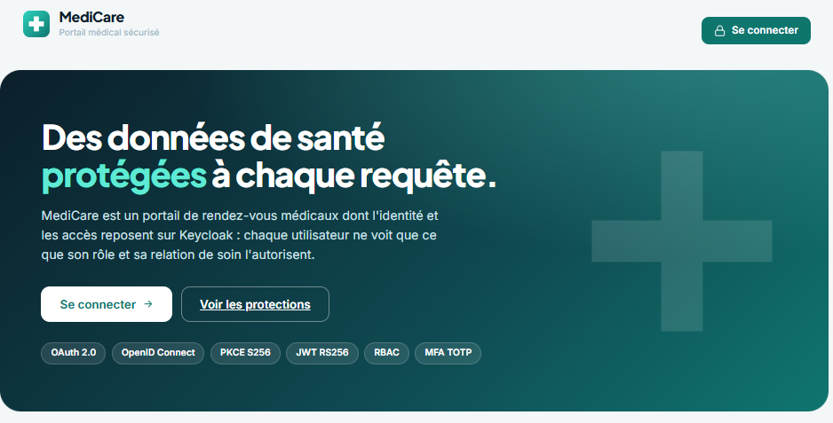

## L'essentiel en un coup d'œil

| Ce que fait le projet | Comment | Preuve |
|---|---|---|
| Le mot de passe n'est jamais saisi dans l'application | Authorization Code + PKCE `S256`, client public | `code_verifier` incorrect : `invalid_grant` |
| Un jeton ne se falsifie pas | JWT signé RS256, vérifié avec les clés publiques (JWKS) | Rôle modifié : `401 Invalid signature` |
| Un jeton ne sert que pour cette API | Contrôle de l'audience `medicare-api` | Autre audience : `401 The aud claim is not valid` |
| Chacun n'accède qu'à ce que son rôle permet | 4 rôles, une zone d'API par rôle | 16 cas (4 rôles × 4 zones) conformes |
| Chacun ne voit que **ses** données | Le `sub` du jeton est comparé au propriétaire de la donnée | Patient sur le dossier d'un autre : `403` |
| Un administrateur compromis ne lit pas les dossiers | Séparation des tâches | Secrétaire et admin sur un dossier : `403` |
| Les comptes médecins sont mieux protégés | MFA TOTP exigé seulement pour le rôle `DOCTOR` | Patient sans code, médecin avec code |
| Chaque décision est traçable | Journal d'audit `ALLOWED` / `DENIED` | Consultable par l'administrateur |

## Schéma du projet

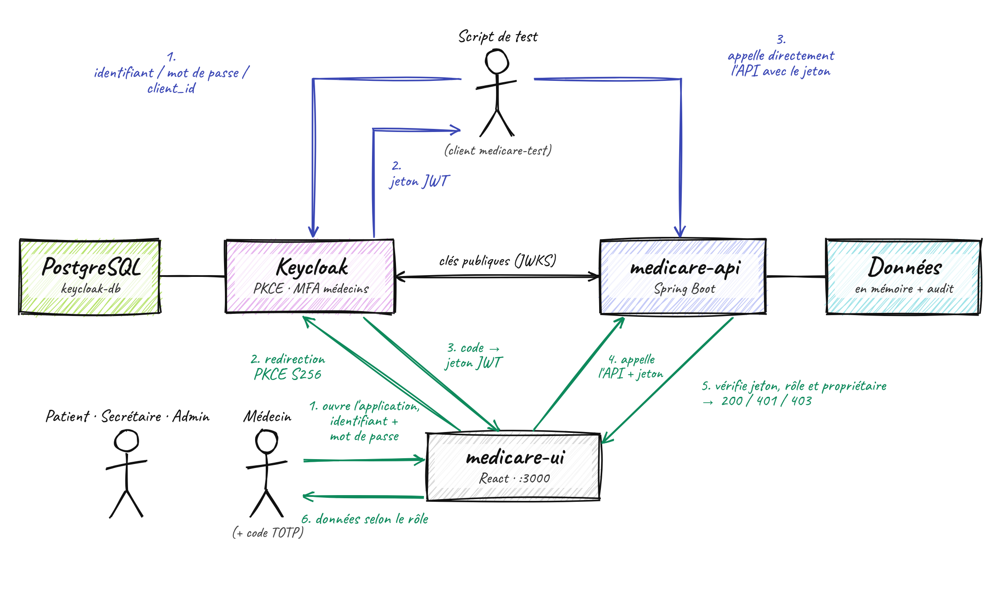

| Flux | Étape | Ce qui se passe |
|---|---|---|
| Interface (vert) | 1 | L'utilisateur ouvre `medicare-ui` |
| | 2 | `medicare-ui` le redirige vers Keycloak (PKCE) ; il s'y connecte, avec un code TOTP s'il est médecin |
| | 3 | Keycloak renvoie un jeton JWT signé (rôles, audience `medicare-api`) |
| | 4 | `medicare-ui` appelle l'API avec `Authorization: Bearer <jeton>` |
| | 5 | L'API valide le jeton (JWKS), contrôle le rôle puis le propriétaire, et répond `200`, `401` ou `403` |
| | 6 | `medicare-ui` affiche les données selon le rôle |
| Direct (bleu) | 1-3 | Un script obtient un jeton (client `medicare-test`) et appelle l'API directement |

<details>
<summary>Déroulement détaillé d'une connexion (diagramme de séquence)</summary>

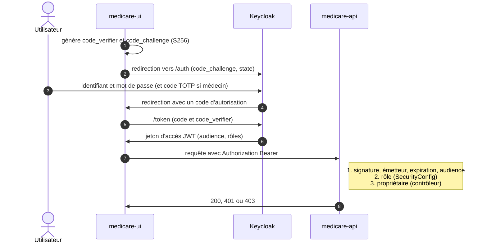

</details>

## Modèle d'accès

| Rôle | Rendez-vous | Dossiers médicaux | Journal d'audit |
|---|---|---|---|
| `PATIENT` | les siens | uniquement les siens | refusé |
| `DOCTOR` (MFA) | ceux de ses patients | uniquement ceux de ses patients | refusé |
| `SECRETARY` | tous, peut **confirmer** | **refusé** | refusé |
| `ADMIN` | refusé | **refusé** | consultation |

Le contrôle a **deux niveaux** : le rôle (`SecurityConfig`), puis l'objet (les contrôleurs comparent le `sub`
signé du jeton au propriétaire de la donnée). Avoir le bon rôle ne suffit pas.

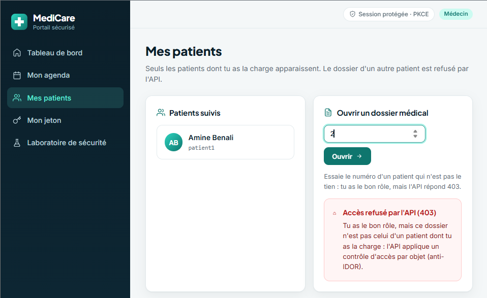

## Applications

### medicare-api

| Endpoint | Sécurisé | Rôles | Règle supplémentaire |
|---|---|---|---|
| `GET /api/health` | Non | | |
| `GET /api/me` | Oui | tout utilisateur connecté | identité lue dans le jeton |
| `GET /api/appointments` | Oui | `PATIENT`, `DOCTOR`, `SECRETARY` | résultat filtré selon le rôle |
| `PUT /api/appointments/{id}/confirm` | Oui | `SECRETARY` | |
| `GET /api/records/{id}` | Oui | `PATIENT`, `DOCTOR` | propriétaire ou médecin de soin, sinon `403` |
| `GET /api/patients/me/records` | Oui | `PATIENT` | ses propres dossiers |
| `GET /api/doctors/me/patients` | Oui | `DOCTOR` | ses patients |
| `GET /api/admin/audit` | Oui | `ADMIN` | journal des décisions d'accès |

### medicare-ui

Connexion PKCE avec `keycloak-js`, menus et tableau de bord selon le rôle, page **Mon jeton** qui décode ce que
Keycloak a émis, et **laboratoire de sécurité** qui rejoue des accès interdits. Le jeton reste en mémoire du
navigateur (jamais dans `localStorage`).

| | |
|---|---|
| 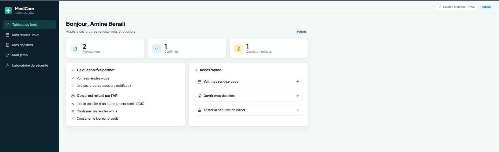 | 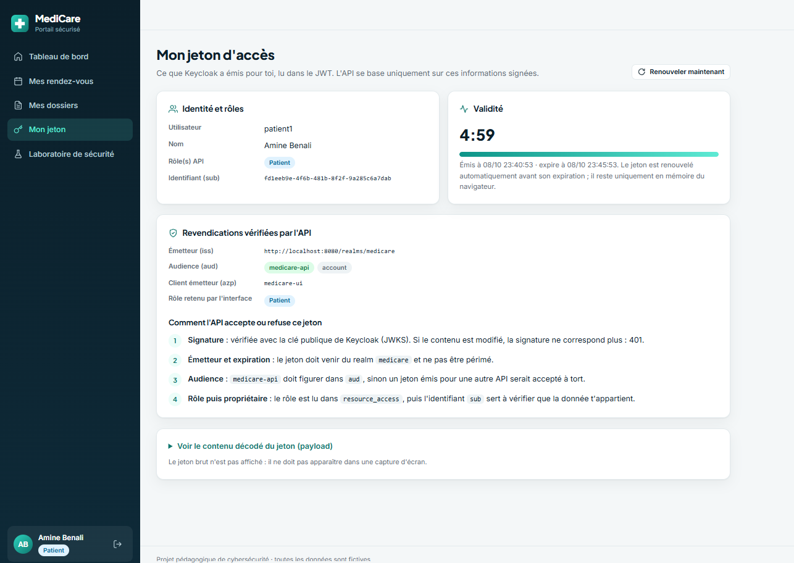 |
| Tableau de bord du patient | Contenu du jeton : audience, rôles, validité |
| 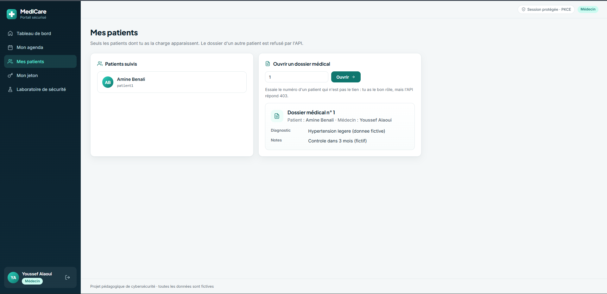 | 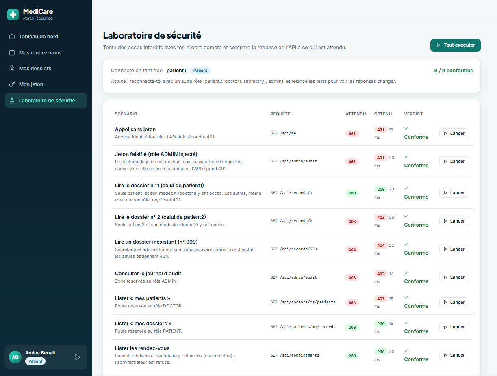 |
| Le médecin ouvre le dossier de son patient | Laboratoire de sécurité : attendu et obtenu |

## Démarrage rapide

**Prérequis :** Docker Desktop, Java 21, Node.js 18 ou plus récent.

**1. Keycloak** (à la racine du dépôt) :

```bash
docker compose up -d
```

Au premier démarrage, Keycloak importe automatiquement le realm `medicare` (environ une minute) :

- clients `medicare-ui` (public, PKCE `S256`), `medicare-api` (porte les rôles) et `medicare-test` (tests) ;
- rôles `PATIENT`, `DOCTOR`, `SECRETARY`, `ADMIN` et groupes correspondants ;
- flux `browser-doctor-mfa` : code TOTP exigé seulement pour le rôle `DOCTOR` ;
- 6 comptes de démonstration.

**2. API** (nouveau terminal) :

```bash
cd medicare-api
./mvnw spring-boot:run          # Windows : mvnw.cmd spring-boot:run
```

**3. Interface** (nouveau terminal) :

```bash
cd medicare-ui
npm install
npm run dev
```

| Application | URL | Identifiants |
|---|---|---|
| medicare-ui | http://localhost:3000 | comptes ci-dessous |
| medicare-api | http://localhost:9080/api/health | jeton d'accès |
| Keycloak | http://localhost:8080 | `admin` / `admin` |

| Utilisateur | Rôle | Mot de passe | MFA |
|---|---|---|---|
| `patient1`, `patient2` | Patient | identique à l'utilisateur | non |
| `doctor1`, `doctor2` | Médecin | identique à l'utilisateur | **code TOTP** |
| `secretary1` | Secrétaire | identique à l'utilisateur | non |
| `admin1` | Administrateur | identique à l'utilisateur | non |

### Activer le MFA d'un médecin

À sa première connexion, le médecin voit cet écran. Sans téléphone, un script joue le rôle de l'application
d'authentification :

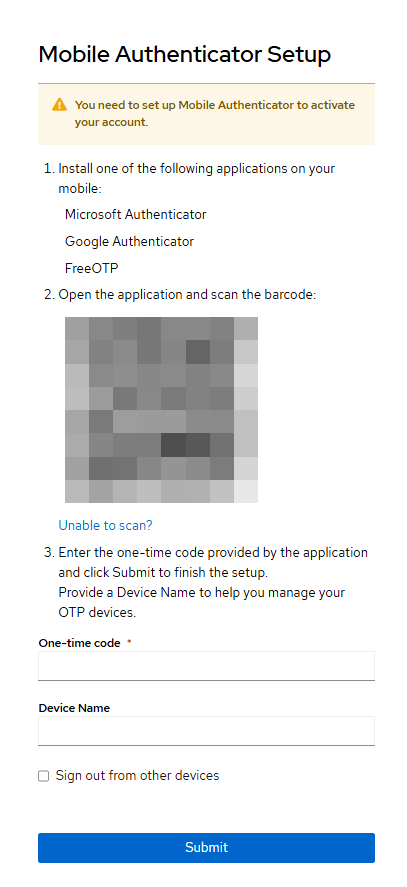

1. Se connecter avec `doctor1` / `doctor1`, cliquer sur **Unable to scan?** et copier la clé.
2. Enregistrer la clé et obtenir un code :
   ```bash
   node tests/otp-enroll.js doctor1 "<clé affichée>"
   ```
3. Saisir le code dans Keycloak, donner un nom d'appareil, valider.

Ensuite, à chaque connexion : `node tests/otp-code.js doctor1`.

## Tester medicare-api

### Avec curl

```bash
# 1. jeton du compte patient1 (client de test, local uniquement)
ACCESS_TOKEN="$(curl -s -X POST \
  "http://localhost:8080/realms/medicare/protocol/openid-connect/token" \
  -H "Content-Type: application/x-www-form-urlencoded" \
  -d "username=patient1" -d "password=patient1" \
  -d "grant_type=password" -d "client_id=medicare-test" | jq -r .access_token)"

# 2. sans jeton : 401
curl -i http://localhost:9080/api/me

# 3. avec jeton : 200
curl -i http://localhost:9080/api/me -H "Authorization: Bearer $ACCESS_TOKEN"

# 4. IDOR, dossier de patient2 : 403
curl -i http://localhost:9080/api/records/2 -H "Authorization: Bearer $ACCESS_TOKEN"
```

Sans `jq` ou sous Windows : `node tests/get-tokens.js` obtient un jeton pour les 6 comptes.

### 27 scénarios automatiques

```bash
node tests/get-tokens.js
node tests/check-access.js
```

Résultat : `TOUS LES TESTS PASSENT (27)`.

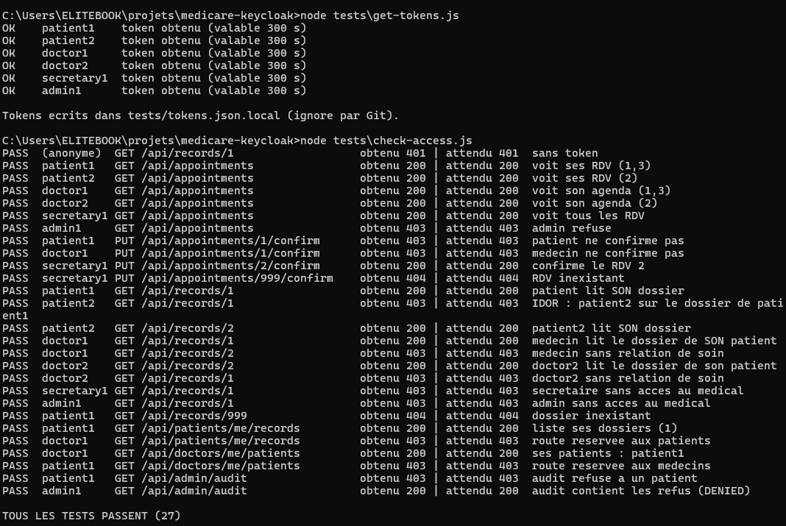

| Attaque testée | Résultat observé |
|---|---|
| Appel sans jeton | `401` |
| `code_verifier` PKCE incorrect | `invalid_grant` |
| Jeton modifié (rôle changé, signature conservée) | `401`, `Invalid signature` |
| Jeton pour une autre audience | `401`, `The aud claim is not valid` |
| Mauvais rôle sur une zone | `403` |
| Dossier d'un autre patient (IDOR) | `403` |
| Secrétaire ou admin sur un dossier médical | `403` |

## Configuration Keycloak

| Élément | Valeur |
|---|---|
| Realm | `medicare` |
| `medicare-ui` | client public, Standard flow + PKCE `S256`, flux Password et Implicit désactivés |
| `medicare-api` | client sans flux ni URL : il porte les client roles |
| Groupes | `PATIENTS`, `DOCTORS`, `SECRETARIES`, `ADMINS`, chacun lié à un rôle |
| Flux de connexion | `browser-doctor-mfa` : mot de passe, puis sous-flux conditionnel (rôle `DOCTOR`) + OTP |

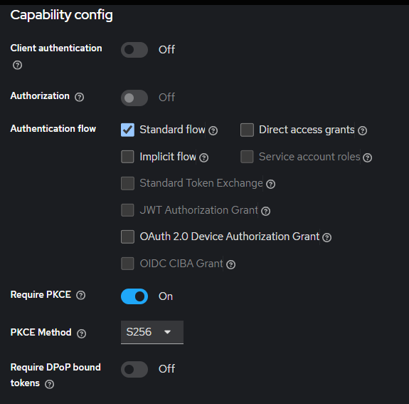

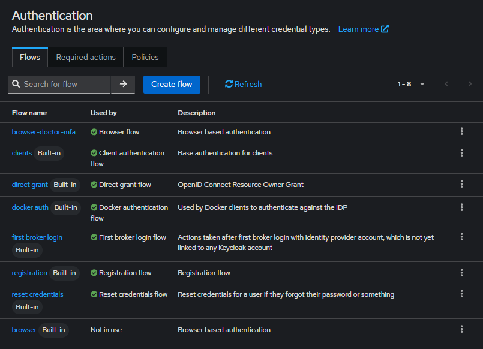

La configuration est reproductible : le realm est exporté **sans comptes ni secrets** (`keycloak/realm-export.json`)
et `node keycloak/build-import.js` y ajoute les comptes de démonstration avant l'import automatique.

## Commandes utiles

| Action | Commande |
|---|---|
| État des conteneurs | `docker compose ps` |
| Journal de Keycloak | `docker compose logs -f keycloak` |
| Arrêter en gardant les données | `docker compose down` |
| Tout supprimer (realm, comptes, appareils OTP) | `docker compose down -v` |

## Limites connues

Annoncées volontairement ; le détail et les correctifs sont dans [`docs/threat-model.md`](docs/threat-model.md).

- Keycloak tourne en `start-dev` : HTTP, administrateur `admin` / `admin`. Une mise en production exige HTTPS.
- Le client `medicare-test` contourne l'écran de connexion (donc le MFA d'un médecin sans OTP) : développement uniquement.
- Les données et le journal d'audit sont en mémoire, réinitialisés au redémarrage de l'API.
- Un dossier interdit répond `403` et un dossier inexistant `404` : cela révèle quels numéros existent.
- Pas de protection contre la force brute ni de politique CSP.

## Documentation

- [`docs/decisions.md`](docs/decisions.md) : pourquoi chaque choix de conception (12 décisions).
- [`docs/threat-model.md`](docs/threat-model.md) : 18 menaces, contre-mesures, preuves et risques résiduels.
