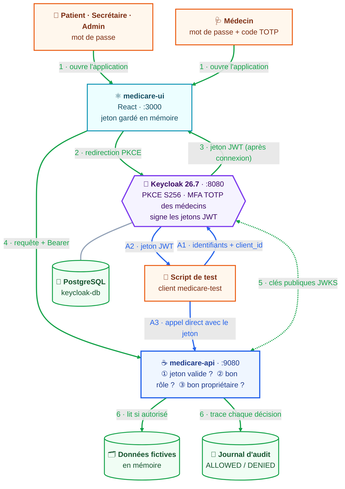

# MediCare : portail médical sécurisé par Keycloak

Portail de rendez-vous médicaux sécurisé avec [Keycloak](https://www.keycloak.org/) (OAuth 2.0, OpenID Connect,
Authorization Code + **PKCE**). `medicare-app` se compose de deux applications : une API REST Spring Boot,
**medicare-api**, et une application React, **medicare-ui**. Accès par **rôle** et par **objet** (anti-IDOR),
**MFA** pour les médecins, **journal d'audit**.


## Schéma du projet



| Flux | Étape | Ce qui se passe |
|---|---|---|
| Interface (vert) | 1 | L'utilisateur ouvre `medicare-ui` |
| | 2 | `medicare-ui` le redirige vers Keycloak (PKCE `S256`) ; il s'y connecte, avec un code TOTP s'il est médecin |
| | 3 | Keycloak renvoie un jeton d'accès **JWT** signé (rôles, audience `medicare-api`) |
| | 4 | `medicare-ui` appelle l'API avec `Authorization: Bearer <jeton>` |
| | 5 | L'API valide le jeton avec les clés **publiques** de Keycloak (JWKS) |
| | 6 | L'API contrôle le rôle puis le propriétaire (`sub`), lit les données et journalise la décision |
| Direct (bleu) | A1-A3 | Un script obtient un jeton auprès de Keycloak (client `medicare-test`) et appelle l'API directement |

## Applications

### medicare-api

API Spring Boot (Java 21). Ses endpoints sécurisés ne sont accessibles qu'avec un jeton JWT émis par Keycloak.
Les données sont en mémoire.

| Endpoint | Sécurisé | Rôles | Règle supplémentaire |
|---|---|---|---|
| `GET /api/health` | Non | | |
| `GET /api/me` | Oui | tout utilisateur connecté | identité lue dans le jeton |
| `GET /api/appointments` | Oui | `PATIENT`, `DOCTOR`, `SECRETARY` | résultat filtré selon le rôle |
| `PUT /api/appointments/{id}/confirm` | Oui | `SECRETARY` | |
| `GET /api/records/{id}` | Oui | `PATIENT`, `DOCTOR` | propriétaire ou médecin de soin, sinon `403` |
| `GET /api/patients/me/records` | Oui | `PATIENT` | ses propres dossiers |
| `GET /api/doctors/me/patients` | Oui | `DOCTOR` | ses patients |
| `GET /api/admin/audit` | Oui | `ADMIN` | journal des décisions d'accès |

### medicare-ui

Application React (Vite) : connexion PKCE, menus et tableau de bord selon le rôle, page **Mon jeton**, et
**laboratoire de sécurité** qui rejoue des accès interdits. Le jeton reste en mémoire du navigateur.

## Prérequis

- Docker Desktop
- Java 21
- Node.js 18 ou plus récent

## Démarrer l'environnement

À la racine du dépôt :

```bash
docker compose up -d
```

Au premier démarrage, Keycloak importe automatiquement le realm `medicare` (environ une minute). L'import :

- crée le realm `medicare` et les clients `medicare-ui` (PKCE `S256`), `medicare-api` (porte les rôles) et `medicare-test` (tests) ;
- crée les rôles `PATIENT`, `DOCTOR`, `SECRETARY`, `ADMIN` et les groupes correspondants ;
- crée le flux `browser-doctor-mfa` : code TOTP exigé seulement pour le rôle `DOCTOR` ;
- crée les 6 comptes de démonstration.

## Lancer medicare-app

**medicare-api** (nouveau terminal) :

```bash
cd medicare-api
./mvnw spring-boot:run          # Windows : mvnw.cmd spring-boot:run
```

**medicare-ui** (nouveau terminal) :

```bash
cd medicare-ui
npm install
npm run dev
```

## URL des applications

| Application | URL | Identifiants |
|---|---|---|
| medicare-ui | http://localhost:3000 | comptes ci-dessous |
| medicare-api | http://localhost:9080/api/health | jeton d'accès |
| Keycloak | http://localhost:8080 | `admin` / `admin` |

| Utilisateur | Rôle | Mot de passe | MFA |
|---|---|---|---|
| `patient1`, `patient2` | Patient | identique à l'utilisateur | non |
| `doctor1`, `doctor2` | Médecin | identique à l'utilisateur | **code TOTP** |
| `secretary1` | Secrétaire | identique à l'utilisateur | non |
| `admin1` | Administrateur | identique à l'utilisateur | non |

### Activer le MFA d'un médecin

À sa première connexion, le médecin voit cet écran. Sans téléphone, un script joue le rôle de l'application
d'authentification :


1. Se connecter avec `doctor1` / `doctor1`, puis cliquer sur **Unable to scan?** et copier la clé.
2. Enregistrer la clé et obtenir un code :
   ```bash
   node tests/otp-enroll.js doctor1 "<clé affichée>"
   ```
3. Saisir le code dans Keycloak, donner un nom d'appareil, valider.

Ensuite, à chaque connexion : `node tests/otp-code.js doctor1`.

## Démonstration

| | |
|---|---|
|  |  |
| Tableau de bord du patient | Contenu du jeton : audience, rôles, validité |
|  |  |
| Un médecin refusé (`403`) sur un patient dont il n'a pas la charge | Laboratoire de sécurité |

## Tester medicare-api

### Obtenir un jeton

```bash
ACCESS_TOKEN="$(curl -s -X POST \
  "http://localhost:8080/realms/medicare/protocol/openid-connect/token" \
  -H "Content-Type: application/x-www-form-urlencoded" \
  -d "username=patient1" \
  -d "password=patient1" \
  -d "grant_type=password" \
  -d "client_id=medicare-test" | jq -r .access_token)"
```

Sans `jq` ou sous Windows : `node tests/get-tokens.js` obtient un jeton pour les 6 comptes.

### Appeler les endpoints

Sans jeton, résultat attendu `401` :

```bash
curl -i http://localhost:9080/api/me
```

Avec le jeton, résultat attendu `200` :

```bash
curl -i http://localhost:9080/api/me -H "Authorization: Bearer $ACCESS_TOKEN"
```

Tentative IDOR : `patient1` lit le dossier de `patient2`, résultat attendu `403` :

```bash
curl -i http://localhost:9080/api/records/2 -H "Authorization: Bearer $ACCESS_TOKEN"
```

### Scénarios automatiques

```bash
node tests/get-tokens.js
node tests/check-access.js     # 27 scénarios : rôle, objet, audit
```

Résultat : `TOUS LES TESTS PASSENT (27)`.


| Attaque | Résultat observé |
|---|---|
| Appel sans jeton | `401` |
| `code_verifier` PKCE incorrect | `invalid_grant` |
| Jeton modifié (rôle changé) | `401`, `Invalid signature` |
| Jeton pour une autre audience | `401`, `The aud claim is not valid` |
| Mauvais rôle sur une zone | `403` |
| Dossier d'un autre patient | `403` |
| Secrétaire ou admin sur un dossier médical | `403` |

## Commandes utiles

| Action | Commande |
|---|---|
| État des conteneurs | `docker compose ps` |
| Journal de Keycloak | `docker compose logs -f keycloak` |
| Régénérer le fichier d'import du realm | `node keycloak/build-import.js` |

## Arrêt

- `medicare-api` et `medicare-ui` : `Ctrl+C` dans leurs terminaux.
- Keycloak en gardant les données : `docker compose down`
- Keycloak en supprimant tout (realm, comptes, appareils OTP) : `docker compose down -v`

## Limites connues

Détail dans [`docs/threat-model.md`](docs/threat-model.md).

- Keycloak en `start-dev` : HTTP, administrateur `admin` / `admin`.
- Le client `medicare-test` contourne l'écran de connexion : à supprimer hors développement.
- Données et journal d'audit en mémoire, perdus au redémarrage de l'API.

## Documentation

- [`docs/decisions.md`](docs/decisions.md) : pourquoi chaque choix de conception.
- [`docs/threat-model.md`](docs/threat-model.md) : menaces, contre-mesures, preuves et risques résiduels.
