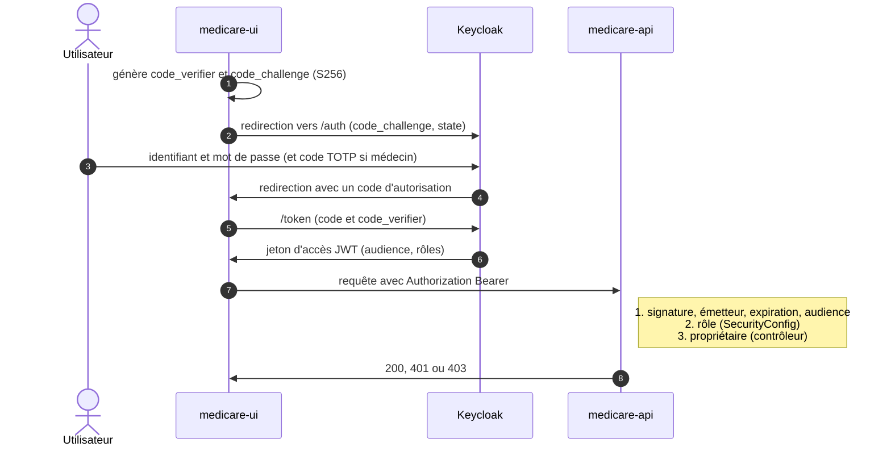
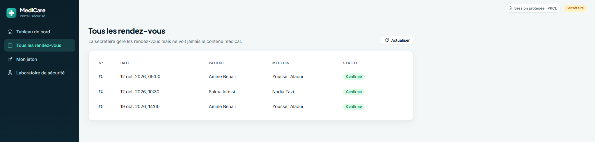

# MediCare : portail médical sécurisé par Keycloak


Le but de ce projet est de sécuriser **medicare-app** avec Keycloak (avec PKCE). `medicare-app` se compose de
deux applications : une API REST Spring Boot appelée **medicare-api** et une application React appelée
**medicare-ui**. Les accès sont contrôlés **par rôle et par objet** (anti-IDOR), les médecins ont un **MFA** et
chaque décision est écrite dans un **journal d'audit**.


## Ce que démontre le projet

| Protection | Comment | Preuve |
|---|---|---|
| Le mot de passe n'est jamais saisi dans l'application | Authorization Code + PKCE `S256`, client public | `code_verifier` incorrect : `invalid_grant` |
| Un jeton ne se falsifie pas | JWT signé RS256, vérifié avec les clés publiques (JWKS) | Rôle modifié : `401 Invalid signature` |
| Un jeton ne sert que pour cette API | Contrôle de l'audience `medicare-api` | Autre audience : `401 The aud claim is not valid` |
| Chacun n'accède qu'à ce que son rôle permet | 4 rôles, une zone d'API par rôle | 16 cas (4 rôles × 4 zones) conformes |
| Chacun ne voit que **ses** données | Le `sub` du jeton est comparé au propriétaire | Patient sur le dossier d'un autre : `403` |
| Un administrateur compromis ne lit pas les dossiers | Séparation des tâches | Secrétaire et admin sur un dossier : `403` |
| Les médecins sont mieux protégés | MFA TOTP exigé seulement pour le rôle `DOCTOR` | Patient sans code, médecin avec code |
| Chaque décision est traçable | Journal d'audit `ALLOWED` / `DENIED` | Consultable par l'administrateur |

## Schéma du projet


Déroulement détaillé d'une connexion :



## Applications

### medicare-api

Application Java Spring Boot qui expose une API REST de rendez-vous et de dossiers médicaux. Ses endpoints
sécurisés ne sont accessibles qu'avec un jeton d'accès (JWT) émis par Keycloak. Les données sont fictives et
gardées en mémoire.

| Endpoint | Sécurisé | Rôles | Règle supplémentaire |
|---|---|---|---|
| `GET /api/health` | Non | | |
| `GET /api/me` | Oui | tout utilisateur connecté | identité lue dans le jeton |
| `GET /api/appointments` | Oui | `PATIENT`, `DOCTOR`, `SECRETARY` | résultat filtré selon le rôle |
| `PUT /api/appointments/{id}/confirm` | Oui | `SECRETARY` | |
| `GET /api/records/{id}` | Oui | `PATIENT`, `DOCTOR` | propriétaire ou médecin de soin, sinon `403` |
| `GET /api/patients/me/records` | Oui | `PATIENT` | ses propres dossiers |
| `GET /api/doctors/me/patients` | Oui | `DOCTOR` | ses patients |
| `GET /api/admin/audit` | Oui | `ADMIN` | journal des décisions d'accès |

Le contrôle a deux niveaux : le rôle (`SecurityConfig`), puis l'objet (le `sub` signé du jeton est comparé au
propriétaire de la donnée).

| Rôle | Rendez-vous | Dossiers médicaux | Journal d'audit |
|---|---|---|---|
| `PATIENT` | les siens | uniquement les siens | refusé |
| `DOCTOR` (MFA) | ceux de ses patients | uniquement ceux de ses patients | refusé |
| `SECRETARY` | tous, peut **confirmer** | **refusé** | refusé |
| `ADMIN` | refusé | **refusé** | consultation |

### medicare-ui

Application React où chaque utilisateur se connecte avec son compte, géré par Keycloak. Les menus et le tableau
de bord dépendent du rôle, une page **Mon jeton** décode ce que Keycloak a émis, et un **laboratoire de
sécurité** rejoue des accès interdits. Toutes les requêtes vers les endpoints sécurisés de `medicare-api`
incluent le jeton obtenu à la connexion, gardé en mémoire du navigateur.

## Prérequis

- Java 21
- Node.js 18 ou plus récent (npm)
- Docker Desktop (ou autre outil de conteneurs)

## PKCE

Comme Keycloak prend en charge PKCE (Proof Key for Code Exchange), nous l'utilisons dans ce projet : le client
`medicare-ui` est public, donc un code d'autorisation intercepté est inutilisable sans le `code_verifier`.

## Démarrer l'environnement

Dans un terminal, à la racine du dépôt :

```bash
docker compose up -d
```

Pour arrêter : `docker compose down` (garde les données) ou `docker compose down -v` (supprime aussi le realm,
les comptes et les appareils OTP).

## Initialiser Keycloak

Il n'y a aucun script à lancer : au premier démarrage, Keycloak importe automatiquement
`keycloak/realm-medicare.json` (environ une minute). Cet import va :

- créer le realm `medicare` ;
- créer le client `medicare-ui` (public, PKCE `S256`, Password et Implicit désactivés) ;
- créer le client `medicare-api`, qui porte les rôles ;
- créer le client `medicare-test`, réservé aux tests locaux ;
- créer les rôles `PATIENT`, `DOCTOR`, `SECRETARY`, `ADMIN` ;
- créer les groupes `PATIENTS`, `DOCTORS`, `SECRETARIES`, `ADMINS` et leur associer chacun son rôle ;
- créer le flux `browser-doctor-mfa` : code TOTP exigé seulement pour le rôle `DOCTOR` ;
- créer les 6 comptes de démonstration.


Le realm est exporté **sans comptes ni secrets** (`keycloak/realm-export.json`) ; `node keycloak/build-import.js`
y ajoute les comptes de démonstration pour produire le fichier d'import.

## Lancer medicare-app

**medicare-api** : dans un terminal, depuis le dossier `medicare-api` :

```bash
./mvnw spring-boot:run          # Windows : mvnw.cmd spring-boot:run
```

**medicare-ui** : dans un autre terminal, depuis le dossier `medicare-ui` :

```bash
npm install                     # première fois seulement
npm run dev
```

## URL des applications

| Application | URL | Identifiants |
|---|---|---|
| medicare-ui | http://localhost:3000 | comptes ci-dessous |
| medicare-api | http://localhost:9080/api/health | jeton d'accès |
| Keycloak | http://localhost:8080 | `admin` / `admin` |

| Utilisateur | Rôle | Mot de passe | MFA |
|---|---|---|---|
| `patient1`, `patient2` | Patient | identique à l'utilisateur | non |
| `doctor1`, `doctor2` | Médecin | identique à l'utilisateur | **code TOTP** |
| `secretary1` | Secrétaire | identique à l'utilisateur | non |
| `admin1` | Administrateur | identique à l'utilisateur | non |

### Activer le MFA d'un médecin

À sa première connexion, le médecin voit cet écran. Sans téléphone, un script joue le rôle de l'application
d'authentification :


1. Se connecter avec `doctor1` / `doctor1`, cliquer sur **Unable to scan?** et copier la clé.
2. Enregistrer la clé et obtenir un code :
   ```bash
   node tests/otp-enroll.js doctor1 "<clé affichée>"
   ```
3. Saisir le code dans Keycloak, donner un nom d'appareil, valider.

Ensuite, à chaque connexion : `node tests/otp-code.js doctor1`.

## Démonstration

| | |
|---|---|
|  |  |
| Tableau de bord du patient | Contenu du jeton : audience, rôles, validité |
|  |  |
| Le médecin ouvre le dossier de son patient | Refus `403` sur un patient dont il n'a pas la charge |
|  |  |
| La secrétaire voit les rendez-vous, sans contenu médical | Laboratoire de sécurité : attendu et obtenu |

## Tester les endpoints de medicare-api

On peut appeler les endpoints directement avec `curl`. Les endpoints sécurisés exigent un jeton émis par Keycloak.

### Obtenir un jeton d'accès

```bash
ACCESS_TOKEN="$(curl -s -X POST \
  "http://localhost:8080/realms/medicare/protocol/openid-connect/token" \
  -H "Content-Type: application/x-www-form-urlencoded" \
  -d "username=patient1" \
  -d "password=patient1" \
  -d "grant_type=password" \
  -d "client_id=medicare-test" | jq -r .access_token)"

echo $ACCESS_TOKEN
```

Sans `jq` ou sous Windows : `node tests/get-tokens.js` obtient un jeton pour les 6 comptes. On peut décoder un
jeton sur [jwt.io](https://jwt.io).

### Appeler les endpoints avec curl

Sans jeton, résultat attendu `HTTP/1.1 401` :

```bash
curl -i http://localhost:9080/api/me
```

Avec le jeton, résultat attendu `HTTP/1.1 200` :

```bash
curl -i http://localhost:9080/api/me -H "Authorization: Bearer $ACCESS_TOKEN"
```

`patient1` essaie de lire le dossier de `patient2` (IDOR), résultat attendu `HTTP/1.1 403` :

```bash
curl -i http://localhost:9080/api/records/2 -H "Authorization: Bearer $ACCESS_TOKEN"
```

### Scénarios automatiques

```bash
node tests/get-tokens.js
node tests/check-access.js
```

Résultat : `TOUS LES TESTS PASSENT (27)`.


| Attaque testée | Résultat observé |
|---|---|
| Appel sans jeton | `401` |
| `code_verifier` PKCE incorrect | `invalid_grant` |
| Jeton modifié (rôle changé, signature conservée) | `401`, `Invalid signature` |
| Jeton pour une autre audience | `401`, `The aud claim is not valid` |
| Mauvais rôle sur une zone | `403` |
| Dossier d'un autre patient (IDOR) | `403` |
| Secrétaire ou admin sur un dossier médical | `403` |

## Arrêt

- `medicare-api` et `medicare-ui` : `Ctrl+C` dans leurs terminaux.
- Keycloak et ses bases : `docker compose down`, ou `docker compose down -v` pour tout supprimer.

## Documentation

- [`docs/decisions.md`](docs/decisions.md) : pourquoi chaque choix de conception (12 décisions).
- [`docs/threat-model.md`](docs/threat-model.md) : 18 menaces, contre-mesures, preuves et risques résiduels.
